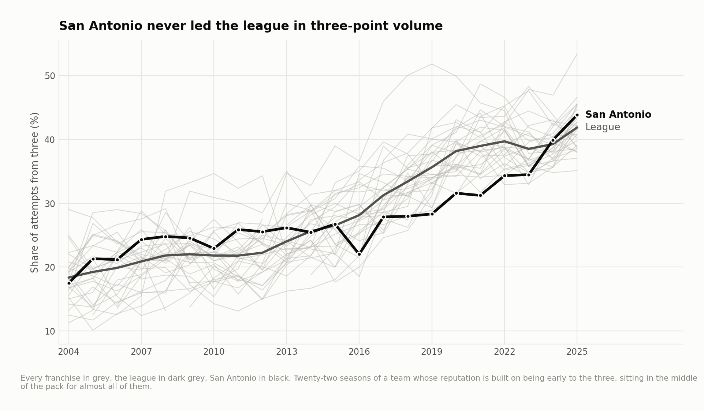
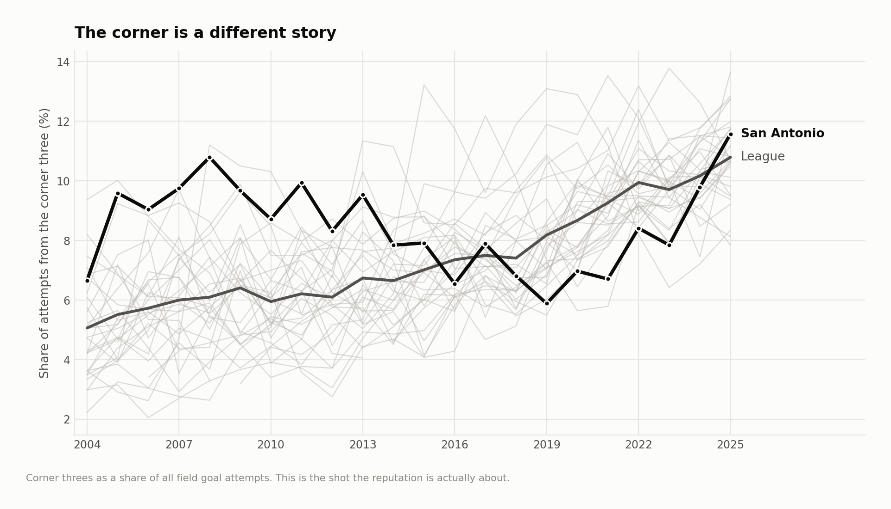
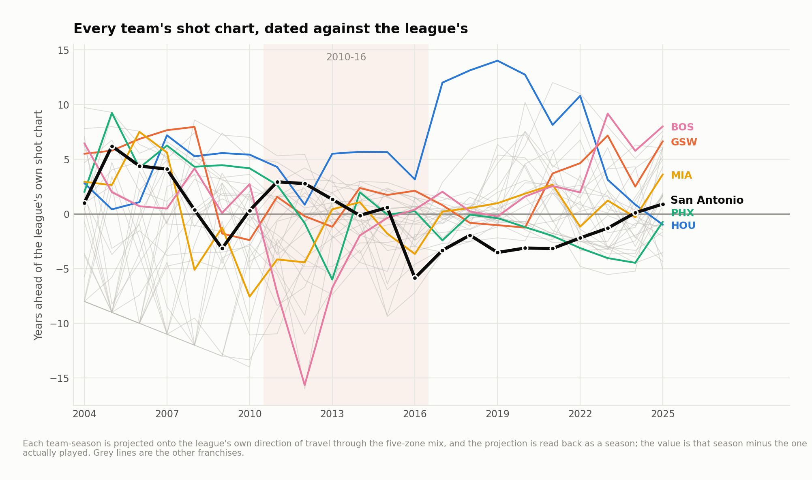
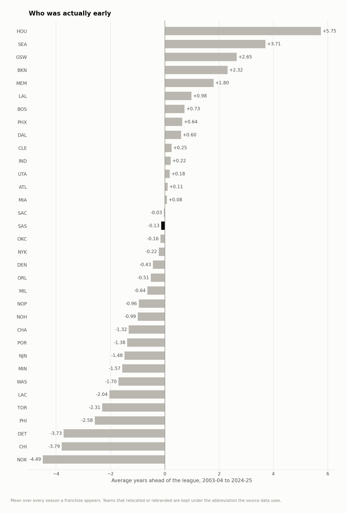
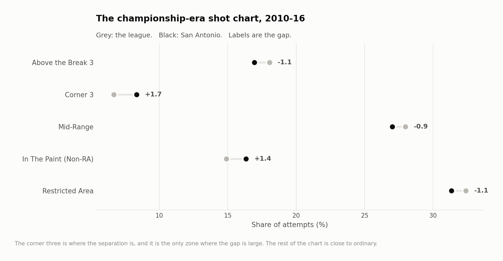

# Did the Spurs invent modern shot selection?

Everyone knows the answer. Bruce Bowen in the corner, Danny Green in the corner,
the extra pass, the Beautiful Game — San Antonio as the franchise that understood
shot value before the league did.

659 team-seasons of shot data, 2003-04 to 2024-25, says the reputation is
half-earned and half-backwards.

**Across twenty-two seasons San Antonio's shot chart sits 0.13 years *behind* the
league's own trajectory — 16th of 34 teams.** Houston is +5.75. Seattle,
over the five seasons it existed in this window, is +3.71. (Relocated and renamed
franchises are counted under each name, which is where 34 comes from.) Golden State is +2.65.
The Spurs are average, and the average conceals two eras that could not be less
alike.

---

## Three different questions

The argument is usually had without settling which claim is being made, so all
three get asked separately.

### Volume: no



San Antonio never led the league in three-point rate. Their best finish in
twenty-two seasons is sixth. From 2018-19 through 2020-21 they finished **30th,
28th and 30th** — last, third-last, last — in a league that had already decided
the argument.

### The corner: yes, and emphatically



This is the part of the reputation that is real. San Antonio finished **first,
second or third in corner-three rate in eight of the nine seasons from 2004-05
through 2012-13**, at a time when the league average was barely six percent of
attempts. They were not shooting more threes than anyone. They were shooting
better ones.

### The whole chart: average, with two opposite halves



Projecting every team-season onto the direction the league itself traveled — out
of the mid-range, into the corners and above the break — dates each shot chart
against the league's own calendar.

| Era | Years ahead of the league |
|---|---|
| 2004-05 to 2006-07 | **+6.2, +4.4, +4.1** |
| 2010-11 to 2012-13 | +2.9, +2.8, +1.3 |
| 2015-16 to 2020-21 | **−5.9, −3.3, −1.9, −3.5, −3.1, −3.2** |
| 2023-24 to 2024-25 | +0.1, +0.9 |

The Bowen-era Spurs were four to six years ahead. The DeMar DeRozan and LaMarcus
Aldridge Spurs were behind by as much as six, and took a larger share of their
shots from the mid-range than any other team in the league in four of the five
seasons from 2016-17 to 2020-21. Same building, same coach, two opposite
philosophies, ten years apart.

---

## Who was actually early



| | Years ahead | Corner rank | Three-rate rank |
|---|---|---|---|
| Houston | **+5.75** | 10.7 | 6.1 |
| Seattle *(5 seasons)* | +3.71 | 14.8 | 10.0 |
| Golden State | +2.65 | 12.7 | 7.9 |
| Brooklyn *(13 seasons)* | +2.32 | 11.2 | 10.2 |
| Memphis | +1.80 | 19.8 | 20.4 |
| **San Antonio** | **−0.13** | 11.7 | 16.7 |
| Philadelphia | −2.58 | 20.4 | 19.4 |
| Detroit | −3.73 | 14.3 | 19.9 |
| Chicago | −3.79 | 19.2 | 20.9 |

Memphis is the interesting name on that list, and the reason is worth stating,
because it is what made me rebuild the metric — and because the rebuild did not
make it go away.

Memphis's +1.80 is an average of two eras pointing opposite ways. The Pau Gasol
teams of 2003-04 to 2007-08, coached first by Hubie Brown and then Mike
Fratello, score +5 to +8. The recent Ja
Morant teams score +2 to +6. In between, the grit-and-grind years everyone
remembers score **−1 to −4.8** — the least modern shot charts in the league at
the time, which the metric gets right and the franchise's reputation does not.

The early ones are the problem. Memphis in 2003-04 took 28.4% of its shots from
the mid-range against a league average of 35.8% — the lowest share in the league.
Its three-point rate was 19.3% against a league average of 18.3%: completely
ordinary. It emptied the mid-range into the rim, not into threes, and the metric
reads that as eight years early. That is not a bug I fixed; it is what the
measurement means, and it is stated as such below.

---

## What the metric is, and why it is not a nearest-neighbour match

The obvious construction is to find the point on the league's path closest to a
team's mix and read off the year. I built that first. It fails in two ways that
have nothing to do with each other.

**It saturates.** The nearest point on the path can only be a season the league
actually played, so any team more extreme than either end of the path gets pinned
to that end. Under a nearest-neighbour match the 2017-18 Rockets — the most
extreme shot chart in the sample by a distance — come out three years ahead,
because there was nothing further along the path to match them to. Denver in
2005-06, whose mix is behind anything the league has done since, comes out as
*contemporary* for the same reason in reverse.

**It puts two different ideas in one number.** A team can be far along the path
or far away from it, and a nearest-neighbour match assigns both to whichever
season happens to be closest. Being unusual and being early end up indistinguishable.

The version in the repository projects instead. The league's own trajectory has a
direction; **98.7% of its movement over twenty-two seasons lies on a single
axis**, weighted:

| Zone | Loading |
|---|---|
| Mid-range | **−0.795** |
| Above-the-break three | **+0.554** |
| Paint, off the rim | +0.185 |
| Corner three | +0.140 |
| At the rim | −0.085 |

Every team-season is projected onto that axis and the projection is read back as
a season using the league's own monotone score-to-year curve. Deviation *across*
the axis — being unusual rather than early — is reported separately, and it is
its own small finding: averaged over their seasons, Houston and Memphis are the
two least conventional franchises in the sample, from opposite directions.

What the projection does not fix is the shape of the axis itself. Mid-range
carries −0.795 and above-the-break threes +0.554, because that is where the
league moved, so emptying the mid-range is worth more than filling the arc.
`output/nn_comparison.csv` has both metrics side by side for all 659
team-seasons; 21% of them sit outside the league path's own range and would have
been pinned to one of its ends by the version I did not keep.

---

## The championship team



Averaged over 2010-11 to 2015-16, the years the argument is usually about:

| | San Antonio | League | Mean rank |
|---|---|---|---|
| Three-point rate | 25.3% | 24.7% | 13.0 of 30 |
| Corner-three rate | **8.3%** | **6.7%** | **7.0 of 30** |
| Mid-range rate | 27.0% | 28.0% | 11.7 of 30 |
| Value of the shot mix | 1.014 | 1.016 | 14.0 of 30 |
| Years ahead of the league | **+0.27** | | |

A very good team with an unremarkable shot chart and one genuinely distinctive
habit. Their three-point rate was six tenths of a point above league average.
Their mix was worth *less* than the league's at fixed conversion. The 2013-14
championship team ranked sixteenth in three-point volume and twelfth in the value
of its shot mix.

None of which is a criticism. It is a claim about what the edge was. That team
won with passing, defense and a center who protected the rim, and it took one
kind of shot better than anyone. Shot selection as a whole was not where it beat
people. It got credited with it afterwards, because by the time the story was
written down the league had decided shot selection was what mattered, and the
Spurs were the team everyone was busy explaining.

---

## What this does not measure

- **Shot selection, not offense.** Where a team shoots from says nothing about
  whether it got a good look there, who created it, or what happened on the
  possessions that ended without a shot.
- **Five zones.** Coarse on purpose: it is the only description of a shot whose
  meaning survives twenty-two years of the NBA changing how it records them. It
  cannot see a 24-footer becoming a 28-footer.
- **Free throws are absent**, so a team that lives at the line looks less
  efficient here than it was.
- **Franchises, not rosters.** Seattle appears for five seasons and Brooklyn for
  thirteen; their averages are over what the data contains, and short samples sit
  higher in the ranking than they have earned.
- **Regular season only.**

---

## Running it

```bash
pip install -r requirements.txt
python src/run_01_build.py   # raw shot files -> a shot profile per team-season
python src/run_02_ahead.py   # the league axis and the dating, figures 01-05
```

Or `make all`. Under a minute.

```
src/
  config.py      paths, seasons, the comparison teams
  features.py    raw rows -> features, coordinate repair, heave filter
  ahead.py       the league axis, the projection, and why it is not a match
  court.py       half-court drawing in the data's own coordinates
  labels.py      collision-resolving point labels
  style.py       one place that decides what every figure looks like
  run_0*.py      the pipeline, in order
output/          every number quoted above, as CSV
figures/         five figures, regenerated from scratch by the pipeline
docs/method.md   longer notes, including the version that did not work
```

## Data

Shot-level files from [DomSamangy/NBA_Shots_04_24](https://github.com/DomSamangy/NBA_Shots_04_24).
`data/README.md` has the fetch step and the two coordinate problems the raw files
carry.

## License

MIT. See `LICENSE`.
